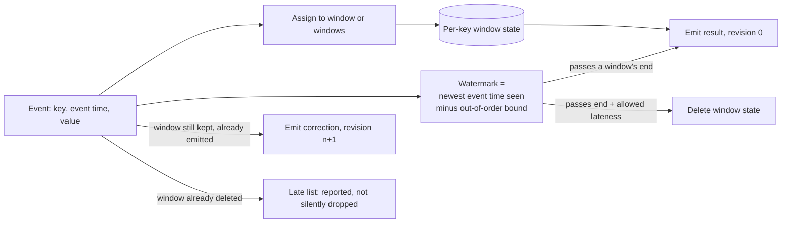

# stream-windowing-engine

Event-time windowed aggregation for streams that arrive out of order: tumbling, sliding and session windows, watermarks, corrections for late data, and checkpointed state that resumes without double-counting.

These are the core ideas behind Apache Flink and Beam, implemented small enough to read. No dependencies. Python 3.10+.

## The problem

Events carry the time they happened. They arrive later, and not in order: a phone goes offline, a queue backs up. If you count "page views per minute" by arrival time you get the wrong minute. If you count by event time you have to decide **when a minute is finished**, because another event for it might still be on its way.



## The trade-off, measured

`python -m streamwin` simulates 5,000 page views over an hour (seeded random data). Most arrive within 2 seconds; 5% are delayed by up to a minute. 877 of them arrive after a newer event has already been seen. The job counts views per page per minute, 240 windows in all, and is compared with a batch job that had all the data.

| Out-of-order bound | Allowed lateness | Windows right first time | Corrections sent | Events dropped as late | Final answer matches batch |
|---:|---:|---:|---:|---:|---|
| 0 s | 0 s | 61.7% | 0 | 118 | no |
| 5 s | 0 s | 66.2% | 0 | 99 | no |
| 60 s | 0 s | 100.0% | 0 | 0 | yes |
| 5 s | 60 s | 66.2% | 99 | 0 | yes |
| 0 s | 120 s | 61.7% | 118 | 0 | yes |

There is no setting that is both immediate and always right. You can wait (row 3: correct, but every result is a minute old), or answer early and send corrections (rows 4 and 5: fast first answers, a third of them revised). Rows 1 and 2 are what happens when you do neither: data is lost. That is the decision this engine makes explicit.

## What is implemented

| Piece | Behaviour |
|---|---|
| `Tumbling(size)` | Fixed, non-overlapping windows |
| `Sliding(size, slide)` | Overlapping windows; one event counts in `size / slide` of them |
| `Session(gap)` | Per-key windows that close after a gap of silence. A late event can bridge two sessions into one |
| Watermark | Newest event time seen minus `max_out_of_order`. A window fires when the watermark passes its end |
| `allowed_lateness` | How long a fired window's state is kept so late events can correct it. Corrections carry a higher `revision` |
| Late output | Events too late even for that go to `agg.late` with the watermark at the time |
| Custom aggregates | `init`, `add`, and `merge` (for sessions): sums, counts, max, distinct sets |
| Checkpoints | `checkpoint()` saves state, watermark and the input offset together; `restore()` plus replay from that offset resumes |

## How it is tested

30 tests. The important ones are properties rather than examples:

- **Streaming equals batch.** For each window type and 5 random seeds, 400 events are shuffled within a bound and the result is compared with a batch computation over the sorted events. They must be identical, with no late events and no corrections.
- **Too small a bound still converges.** With heavy disorder and generous lateness, some first results are wrong, corrections are sent, and the final values still equal the batch answer.
- **Nothing vanishes.** With lateness set to zero, counted events plus events in the late list add up to every event sent.
- **Checkpoint and replay gives exactly the uninterrupted output**, for all three window types: run 150 events, snapshot, process 80 more, "crash", restore, replay from the saved offset. The emitted results are equal to a run with no crash.
- **Memory is bounded.** After 1,000 events across 7 keys, open windows never exceed 21, regardless of stream length.

```python
from streamwin import Event, Tumbling, WindowedAggregator

agg = WindowedAggregator(Tumbling(60), max_out_of_order=5, allowed_lateness=60)
for event in source:                       # Event(key, ts, value)
    for result in agg.process(event):      # Result(key, start, end, value, revision)
        sink.upsert(result)
agg.flush()
```

```bash
pip install -e ".[dev]"
pytest -q             # 30 tests
python -m streamwin
```

## Limits

- **Single process, in memory.** State is a Python dictionary and a checkpoint is a deep copy. A real system writes snapshots to durable storage and partitions keys across workers.
- **The watermark is a heuristic.** It assumes disorder is bounded. A source that stalls and then delivers hour-old data will have that data treated as late.
- **"Exactly-once" here means state and offset are saved together.** Results emitted between a checkpoint and a crash are emitted again on replay, so the sink must upsert by `(key, start, end, revision)`. The test shows the combined output is correct; it does not make an external sink transactional.
- **No idle-source handling**: with no new events the watermark does not move and open windows do not fire until `flush()`.
